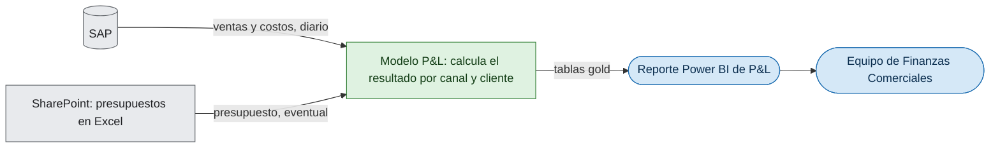
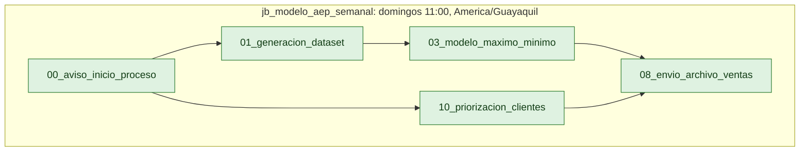
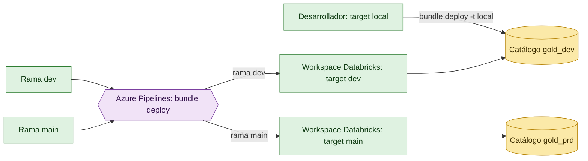
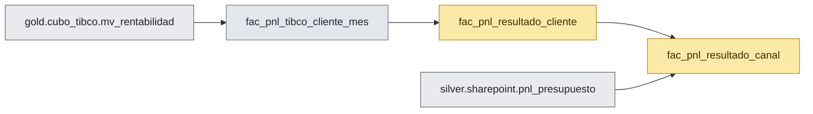
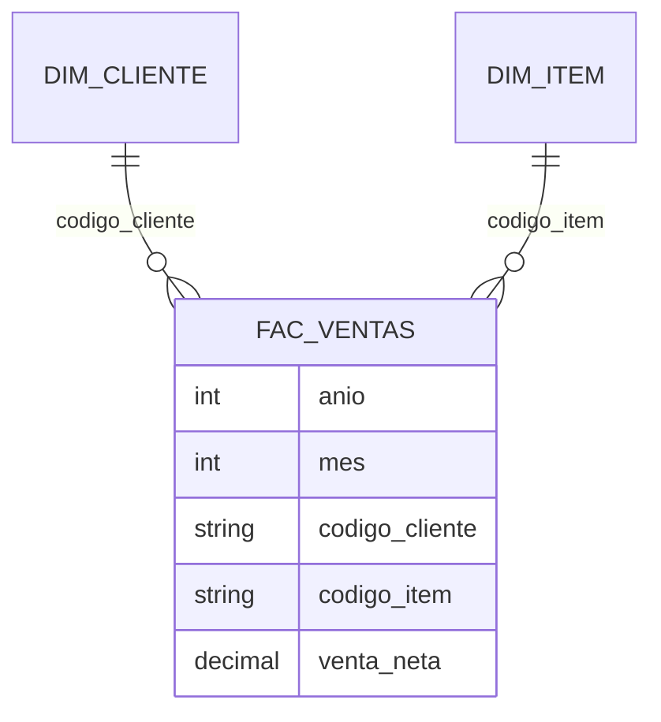
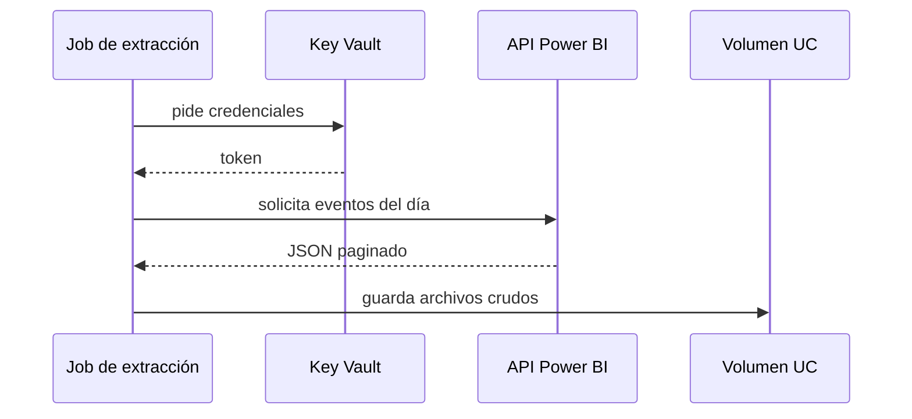

# Diagramas con Mermaid

Los diagramas se escriben como texto Mermaid dentro del Markdown. Así se versionan con
el código, se revisan en un pull request y nadie necesita una herramienta de dibujo.

## Contenido

1. Reglas de compatibilidad (Azure DevOps)
2. Reglas de claridad
3. Paleta y formas
4. Presentación de cada diagrama
5. Modelos: contexto, flujo de datos, orquestación, ambientes, linaje, entidad-relación, secuencia

## 1. Reglas de compatibilidad

Los repositorios viven en Azure DevOps, que dibuja solo una parte de Mermaid. Un
diagrama que se ve bien en VS Code puede aparecer como texto roto allí. Para que
funcione en Azure DevOps, VS Code, GitHub y Databricks a la vez:

| Haz esto | En lugar de esto | Motivo |
|---|---|---|
| `graph LR` o `graph TD` | `flowchart LR` | Azure DevOps no admite `flowchart` |
| Flechas `-->`, `-.->`, `==>` | `---->` (flecha larga) | No se dibuja |
| Texto corto en una línea | `<br/>` u otro HTML | Las etiquetas HTML no se admiten |
| Etiqueta entre comillas: `A["gold.ventas (diaria)"]` | `A[gold.ventas (diaria)]` | Paréntesis, dos puntos, barras y tildes rompen el análisis sin comillas |
| Identificadores simples: `brz_ventas` | Identificadores con puntos, guiones o espacios | El identificador no es la etiqueta |
| Bloque con ```` ```mermaid ```` | `::: mermaid` | El primero funciona en todas partes |
| Texto para decir de qué tipo es algo | Iconos `fa:fa-...` | Font Awesome no se admite |

Tipos de diagrama admitidos: `graph`, `sequenceDiagram`, `erDiagram`,
`stateDiagram`, `gantt`, `classDiagram`, `pie`, `journey`, `timeline`. No uses
`C4Context`, `mindmap`, `sankey`, `block` ni `architecture`.

El validador (`scripts/validar_docs.py`) detecta las infracciones más comunes.

## 2. Reglas de claridad

- **Una pregunta por diagrama.** Si intenta responder dos, son dos diagramas.
- **De lo general a lo particular.** Primero contexto (el proyecto como una caja),
  después el flujo interno, después el detalle de un job. No mezcles niveles.
- **Máximo unos 15 nodos.** Con más, agrupa (por ejemplo "7 tablas de dimensiones")
  o divide por dominio. Un diagrama que no cabe en la pantalla no se lee.
- **Flechas con un solo sentido**, en la dirección en que viaja el dato o en que una
  tarea habilita a la siguiente. Nada de doble punta.
- **Etiqueta las flechas** cuando no sea obvio qué viaja o cómo: `-->|"API REST, diario"|`.
- **Nombres reales** de tablas, jobs y sistemas, tal como aparecen en el código.
- **Flujo de izquierda a derecha** (`LR`) para datos; de arriba abajo (`TD`) para
  secuencias de tareas largas.
- **El color nunca es el único portador de significado**: el título del grupo dice la
  capa ("Bronze", "Silver"), el color solo refuerza.
- **Exactitud antes que belleza.** No dibujes una conexión que el código no hace.

## 3. Paleta y formas

Usa siempre las mismas clases para que todos los proyectos se vean iguales. Copia este
bloque al final de cada diagrama `graph` y aplica solo las clases que uses:

```
classDef fuente fill:#E8EAED,stroke:#5F6368,color:#202124
classDef bronze fill:#F3D9C4,stroke:#A0522D,color:#3E1F0A
classDef silver fill:#E3E7EC,stroke:#6B7785,color:#1F2933
classDef gold fill:#FBE9A8,stroke:#B8860B,color:#3D2E00
classDef consumo fill:#D5E8F7,stroke:#1F6FB2,color:#0B2E4F
classDef proceso fill:#DFF2E1,stroke:#2E7D32,color:#123D15
classDef control fill:#F1E3F7,stroke:#7B3FA0,color:#32104A
```

| Clase | Qué representa | Forma |
|---|---|---|
| `fuente` | Sistema externo de origen (SAP, Oracle, SharePoint, API) | `[("nombre")]` cilindro si es base de datos, `["nombre"]` si es archivo o API |
| `bronze` | Dato crudo tal como llegó | `["tabla"]` |
| `silver` | Dato limpio y estandarizado | `["tabla"]` |
| `gold` | Dato listo para negocio | `["tabla"]` |
| `consumo` | Quien usa el resultado (Power BI, correo, aplicación, persona) | `(["nombre"])` |
| `proceso` | Job, tarea o notebook | `["nombre"]` |
| `control` | Validaciones, configuración, CI/CD | `{{"nombre"}}` |

## 4. Presentación de cada diagrama

Cada diagrama lleva tres piezas, siempre en este orden:

1. Un título en negrita justo antes: `**Diagrama 2. Flujo de datos del modelo P&L**`
2. El bloque Mermaid.
3. Una línea después: `*Cómo leerlo:* …` que explique en una o dos frases qué
   significan flechas y colores y cuál es la idea principal. Mucha gente no sabe
   leer un diagrama técnico; esta línea es la que lo hace "muy fácil de entender".

Al final de `02_arquitectura.md` anota la fecha de última revisión de los diagramas.

## 5. Modelos

Sustituye los nombres por los reales. No dejes nodos de ejemplo.

### Contexto (README)

El proyecto es una sola caja. Responde: ¿de dónde toma datos y a quién le entrega?

**Diagrama 1. Contexto del proyecto**



*Cómo leerlo:* a la izquierda están los sistemas de donde salen los datos, en el centro
el proyecto y a la derecha quienes usan el resultado. Cada flecha indica qué dato viaja
y con qué frecuencia.

### Flujo de datos (arquitectura medallón)

Responde: ¿por qué etapas pasa el dato y en qué tablas queda?

```mermaid
graph LR
    subgraph origen ["Fuentes"]
        api["API Power BI"]
    end
    subgraph bronze ["Bronze: dato crudo"]
        brz_ws["bronze.api_power_bi.workspaces"]
    end
    subgraph silver ["Silver: dato limpio"]
        slv_ws["silver.api_power_bi.workspaces"]
    end
    subgraph gold ["Gold: listo para negocio"]
        gld_inv["gold.api_power_bi.inventario"]
    end
    subgraph uso ["Consumo"]
        dsh(["Tablero de analítica"])
    end

    api -->|"extracción semanal"| brz_ws
    brz_ws -->|"limpia y renombra"| slv_ws
    slv_ws -->|"agrega por workspace"| gld_inv
    gld_inv --> dsh

    classDef fuente fill:#E8EAED,stroke:#5F6368,color:#202124
    classDef bronze fill:#F3D9C4,stroke:#A0522D,color:#3E1F0A
    classDef silver fill:#E3E7EC,stroke:#6B7785,color:#1F2933
    classDef gold fill:#FBE9A8,stroke:#B8860B,color:#3D2E00
    classDef consumo fill:#D5E8F7,stroke:#1F6FB2,color:#0B2E4F
    class api fuente
    class brz_ws bronze
    class slv_ws silver
    class gld_inv gold
    class dsh consumo
```



Si un proyecto no tiene las tres capas (por ejemplo, un modelo que solo lee gold y
escribe gold), dibuja solo las que existen. No fuerces el medallón.

### Orquestación de un job

Responde: ¿en qué orden corren las tareas y cuáles dependen de cuáles? Un diagrama por
job. Usa los `task_key` reales. Indica la programación en el título del grupo.



Si el job tiene más de 15 tareas, agrupa las que forman una etapa ("Persistencia: 3
tareas") y lista el detalle en la tabla de tareas de `04_operacion.md`.

### Ambientes y despliegue

Responde: ¿cómo llega el código a producción y dónde escribe cada ambiente?



### Linaje de tablas

Responde: ¿de qué tablas sale cada tabla final? Igual que el flujo de datos, pero
solo con tablas y a mayor detalle. Con muchas tablas, haz un diagrama por tabla final
importante en lugar de uno global.



### Entidad-relación (opcional)

Solo para modelos dimensionales o cuando las relaciones entre tablas importan para
quien consulta. Muestra las claves, no todas las columnas.



### Secuencia (opcional)

Solo para integraciones donde importa el orden de las llamadas (autenticación contra
una API, espera de un proceso asíncrono).


